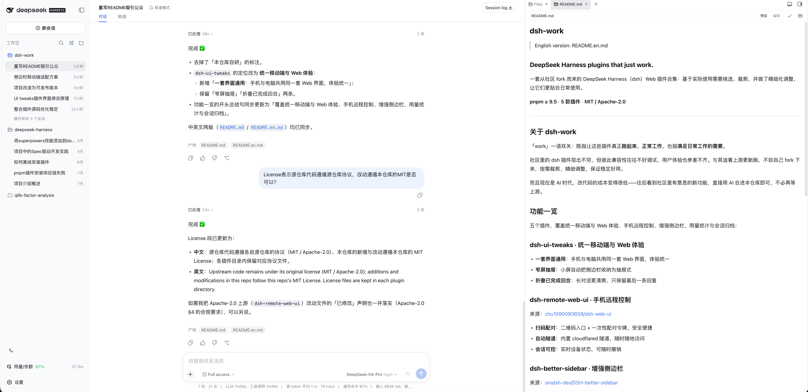

# dsh-work

> 中文版: [README.md](README.md)

### DeepSeek Harness plugins that just work.

A set of DeepSeek Harness (dsh) web plugins forked from the community — picked and trimmed for real-world use, with fine-tuning so they fit your daily workflow.

**pnpm ≥ 9.5** · **5 plugins** · **MIT / Apache-2.0**

---

## About dsh-work

"work" works two ways here: the plugins that actually **work**, and the **work** of getting your daily tasks done.

Community dsh plugins are popping up every day, but compatibility is hard to debug and the experience is rarely consistent. So instead of chasing upstream releases, we fork what's useful, trim and tune it, and keep it stable.

And in the AI era, changing code is cheap — when something interesting shows up in the community, we can just merge it into this repo with AI, no need to wait on upstream.

## Features

Five plugins covering a unified mobile & web experience, mobile remote control, sidebar, usage stats, and archive management:

### dsh-ui-tweaks · Unified mobile & web experience

- **One UI everywhere**: phones and desktop share the same web experience
- **Narrow-screen drawer**: sidebar collapses into a drawer on small screens
- **Fold completed turns**: keep long chats clean, showing only the last reply

### dsh-remote-web-ui · Mobile remote control

Source: [zhu1090093659/dsh-web-ui](https://github.com/zhu1090093659/dsh-web-ui)

- **Scan to pair**: QR entry + one-time pairing tokens, secure and effortless
- **Automatic tunnel**: built-in cloudflared tunnel, works from anywhere
- **Session control**: live device status, revoke anytime

### dsh-better-sidebar · Enhanced sidebar

Source: [omdsh-dev/DSH-better-sidebar](https://github.com/omdsh-dev/DSH-better-sidebar)

- **VSCode-style**: explorer, editor, terminal, git, browser
- **Per-conversation isolation**: each session independent
- **Extensible**: open API for other plugins to register tabs

### dsh-usage-stats · Usage statistics

Source: [Ychris12138/dsh-usage-stats](https://github.com/Ychris12138/dsh-usage-stats)

- **Usage heatmap**: see token consumption at a glance
- **Balances & quotas**: provider balances and subscription quotas in one place

### dsh-archive-manager · Archive management

Source: [z953218350/dsh-archive-manager](https://github.com/z953218350/dsh-archive-manager)

- **Preview, restore, delete** archived conversations from the settings page

## Demo

Desktop — the unified web UI with the enhanced sidebar, here editing this README:



Mobile — remote control, keep the conversation going from anywhere:


## Quick start

Requirements: dsh installed, with **pnpm ≥ 9.5** on your PATH (needed for
git-subdirectory dependencies; npm does not support them).

`dsh plugin` forwards its arguments to pnpm inside the profile directory
(equivalent to `pnpm add …`), then **automatically syncs any dependency that
declares `dsh.bundle` into `dsh.profile.bundles`** (no manual layer-list
maintenance) and initializes the profile on first use.

1. One-time profile config (the aggregate route needs three things: allow the
   native binaries' build scripts, allow git transitive dependencies, and hoist
   the child packages to the profile top level so the loader can resolve them):

   ```sh
   mkdir -p ~/.dsh/profiles/web
   cat > ~/.dsh/profiles/web/pnpm-workspace.yaml <<'EOF'
   allowBuilds:
     cloudflared: true
     node-pty: true
   blockExoticSubdeps: false
   nodeLinker: hoisted
   EOF
   ```

   > Skip if already configured; if the file exists, merge these keys into it.
   > All three are required (verified on pnpm 11): ① build scripts of
   > dependencies are blocked by default → `ERR_PNPM_IGNORED_BUILDS`;
   > ② git (exotic) dependencies are banned in the subdependency position by
   > default → `ERR_PNPM_EXOTIC_SUBDEP`; ③ the default isolated layout does not
   > hoist git child packages to the profile top level → `Cannot find package`
   > at boot. The first two are idempotent — fix and re-run the same command.
   > Per-plugin installs (see step 2 note) only need `allowBuilds`.

2. Install the aggregate package (all 5 plugins at once):

   ```sh
   dsh plugin --profile web add 'github:wptoux/dsh-work#plugins-2026.08.2&path:plugins/dsh-work-all'
   ```

   > `dsh-work-all` is an **aggregate carrier package**: its dependencies pull in
   > all 5 plugins and its `cordis.patch.yml` collects their mount rows, so one
   > command installs everything (it can coexist with standalone installs; the
   > mechanics are documented in `plugins/README.md` under "聚合包"). To pick
   > only some plugins, install them individually instead (per-plugin installs
   > are direct git dependencies, so the profile only needs `allowBuilds`):
   >
   > ```sh
   > dsh plugin --profile web add 'github:wptoux/dsh-work#plugins-2026.08.2&path:plugins/dsh-remote-web-ui'
   > dsh plugin --profile web add 'github:wptoux/dsh-work#plugins-2026.08.2&path:plugins/dsh-better-sidebar'
   > dsh plugin --profile web add 'github:wptoux/dsh-work#plugins-2026.08.2&path:plugins/dsh-usage-stats'
   > dsh plugin --profile web add 'github:wptoux/dsh-work#plugins-2026.08.2&path:plugins/dsh-archive-manager'
   > dsh plugin --profile web add 'github:wptoux/dsh-work#plugins-2026.08.2&path:plugins/dsh-ui-tweaks'
   > ```
   >
   > The equivalent manual way, if you prefer to maintain the profile yourself,
   > is editing `~/.dsh/profiles/web/package.json`:
   >
   > ```json
   > "dependencies": {
   >   "dsh-remote-web-ui":   "github:wptoux/dsh-work#plugins-2026.08.2&path:plugins/dsh-remote-web-ui",
   >   "dsh-better-sidebar":  "github:wptoux/dsh-work#plugins-2026.08.2&path:plugins/dsh-better-sidebar",
   >   "dsh-usage-stats":     "github:wptoux/dsh-work#plugins-2026.08.2&path:plugins/dsh-usage-stats",
   >   "dsh-archive-manager": "github:wptoux/dsh-work#plugins-2026.08.2&path:plugins/dsh-archive-manager",
   >   "dsh-ui-tweaks":       "github:wptoux/dsh-work#plugins-2026.08.2&path:plugins/dsh-ui-tweaks"
   > }
   > ```
   >
   > then run `cd ~/.dsh/profiles/web && pnpm install`. Note the manual way does
   > **not** update `dsh.profile.bundles` automatically — you must keep the
   > package names in that list yourself. That is why `dsh plugin` is recommended.

3. Restart dsh to apply: `Ctrl+C`, then `dsh web` again.

**Upgrade**: re-run `dsh plugin ... add` with the tag (`plugins-2026.08.2`) replaced by the new one (the aggregate command if you installed the aggregate, or per-plugin commands).
**Rollback**: `dsh plugin --profile web remove dsh-work-all` (removes all 5 plugins and the bundles entry at once), or remove plugins one by one; alternatively re-add with the old tag.

## License

Upstream code remains under its original license (MIT / Apache-2.0); additions and modifications in this repo follow this repo's [MIT License](LICENSE). License files are kept in each plugin directory.
