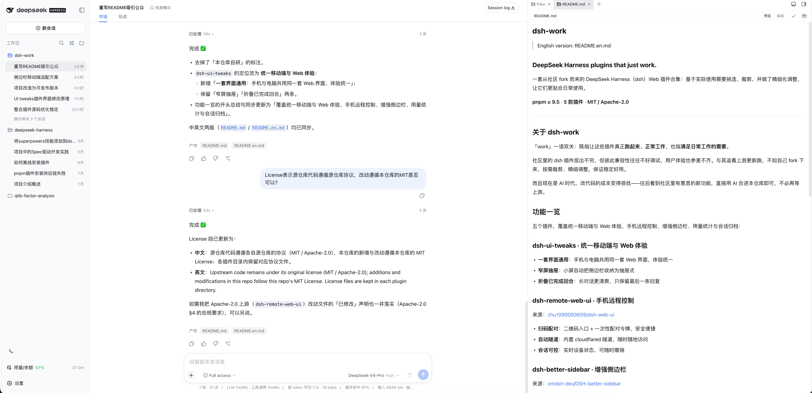

# dsh-work

> English version: [README.en.md](README.en.md)

### DeepSeek Harness plugins that just work.

一套从社区 fork 而来的 DeepSeek Harness（dsh）Web 插件合集：基于实际使用需要挑选、裁剪，并做了精细化调整，让它们更贴合日常使用。

**pnpm ≥ 9.5** · **2 款插件** · **MIT / Apache-2.0**

---

## 关于 dsh-work

「work」一语双关：既指让这些插件真正**跑起来、正常工作**，也指**满足日常工作的需要**。

社区里的 dsh 插件层出不穷，但彼此兼容性往往不好调试，用户体验也参差不齐。与其追着上游更新跑，不如自己 fork 下来，按需裁剪、精细调整，保证稳定好用。

而且现在是 AI 时代，改代码的成本变得很低——往后看到社区里有意思的新功能，直接用 AI 合进本仓库即可，不必再等上游。

## 功能一览

两款插件，覆盖手机远程控制与用量统计：

### dsh-remote-web-ui · 手机远程控制

来源：[zhu1090093659/dsh-web-ui](https://github.com/zhu1090093659/dsh-web-ui)

- **扫码配对**：二维码入口 + 一次性配对令牌，安全便捷
- **自动隧道**：内置 cloudflared 隧道，随时随地访问
- **会话可控**：实时设备状态，可随时撤销

### dsh-usage-stats · 用量统计

来源：[Ychris12138/dsh-usage-stats](https://github.com/Ychris12138/dsh-usage-stats)

- **用量热力图**：token 消耗一目了然
- **余额与配额**：供应商余额、订阅配额集中展示

### 已移除（DSH 0.2.2 原生已覆盖）

以下四款曾收录于本仓库，因内核已提供等价的原生能力而移除：源码保留在 git 历史与 tag
`plugins-2026.09.2`，另有一份整仓备份 `.git-backup/pre-plugin-removal-2026-11-06.bundle`。

| 插件 | 移除原因 |
|---|---|
| `dsh-better-sidebar` | 0.2.x 原生右侧栏（`dsh-client-ui-sidebar-right` + `-files` / `-terminal` / `-documentpreview`）已覆盖文件树、终端、文档预览等同类用法 |
| `dsh-archive-manager` | 内核已有会话归档的原生入口，无需设置页插件卡片 |
| `dsh-model-sync` | 0.2.2 升级 pi-ai 1.3.0 并随内核同步模型目录，不再需要本地接管目录路由 |
| `dsh-ui-tweaks` | 0.2.2 布局自带 `<768px` 侧栏抽屉（`data-sidebar-drawer`），与插件自建抽屉互斥 |

## 演示

桌面端——统一 Web 界面与原生右侧栏，一套改代码、写 README 的日常用法：



移动端——手机远程控制，随时随地继续对话：


## 快速安装

前提：已安装 dsh，且 **pnpm ≥ 9.5** 在 PATH 上（git 子目录依赖需要；npm 不支持）。

`dsh plugin` 把参数转发给 profile 目录里的 pnpm 执行（等价于 `pnpm add …`），装完后
**自动把声明了 `dsh.bundle` 的插件同步进 `dsh.profile.bundles`**（无需手动维护 layer
列表），profile 不存在时自动初始化。

1. 一次性配置 profile（整合包路线需要三项：放行原生二进制构建、放行 git 传递依赖、
   子包提升到 profile 顶层供 loader 解析）：

   ```sh
   mkdir -p ~/.dsh/profiles/web
   cat > ~/.dsh/profiles/web/pnpm-workspace.yaml <<'EOF'
   allowBuilds:
     cloudflared: true
     node-pty: true
   blockExoticSubdeps: false
   nodeLinker: hoisted
   EOF
   ```

   > 已配置过就不用重复做；若 profile 已有该文件，手动合并这几组键即可。三项缺一不可
   > （pnpm 11 实测）：① 默认拦截依赖构建脚本 → `ERR_PNPM_IGNORED_BUILDS`；
   > ② 默认禁止 git（exotic）依赖出现在子依赖位置 → `ERR_PNPM_EXOTIC_SUBDEP`；
   > ③ 默认 isolated 布局不把 git 子包提升到 profile 顶层 → 启动时
   > `Cannot find package`。前两项补上后重跑同一命令即幂等；逐插件安装（见步骤 2 说明）
   > 只需 `allowBuilds` 一项。

2. 安装整合包（当前保留的 2 款插件一次装齐）：

   ```sh
   dsh plugin --profile web add 'github:wptoux/dsh-work#plugins-2026.09.2&path:plugins/dsh-work-all'
   ```

   > `dsh-work-all` 是**聚合载具包**：dependencies 拉入这 2 款插件，`cordis.patch.yml`
   > 汇总它们的挂载行，一条命令全部就位（可与独立安装共存，机制见
   > `plugins/README.md` 的「聚合包」说明）。想按需挑选的话，改为逐个安装
   > （逐插件是直接 git 依赖，profile 只需 `allowBuilds` 两项、不用后两个配置）：
   >
   > ```sh
   > dsh plugin --profile web add 'github:wptoux/dsh-work#plugins-2026.09.2&path:plugins/dsh-remote-web-ui'
   > dsh plugin --profile web add 'github:wptoux/dsh-work#plugins-2026.09.2&path:plugins/dsh-usage-stats'
   > ```
   >
   > 想自己维护 profile 的话，等价的手写方式是编辑 `~/.dsh/profiles/web/package.json`：
   >
   > ```json
   > "dependencies": {
   >   "dsh-remote-web-ui":   "github:wptoux/dsh-work#plugins-2026.09.2&path:plugins/dsh-remote-web-ui",
   >   "dsh-usage-stats":     "github:wptoux/dsh-work#plugins-2026.09.2&path:plugins/dsh-usage-stats"
   > }
   > ```
   >
   > 然后 `cd ~/.dsh/profiles/web && pnpm install`。注意手写方式**不会**自动更新
   > `dsh.profile.bundles`，需要自行保证列表里有对应包名——这正是推荐 `dsh plugin` 的原因。

3. 重启 dsh 生效：`Ctrl+C` 退出后重新 `dsh web`。

**升级**：把命令里的 tag（`plugins-2026.09.2`）换成新 tag 重跑 `dsh plugin ... add`
（装的是整合包就重跑整合包命令，装的是单独插件就逐个重跑）。
**回滚**：`dsh plugin --profile web remove dsh-work-all`（一次移出全部 2 款，并自动从
bundles 移除），或按插件名逐个 `remove`；也可换回旧 tag 重装。

## License

源仓库代码遵循各自源仓库的协议（MIT / Apache-2.0），本仓库的新增与改动遵循本仓库的 [MIT License](LICENSE)；各插件目录内保留对应协议文件。
